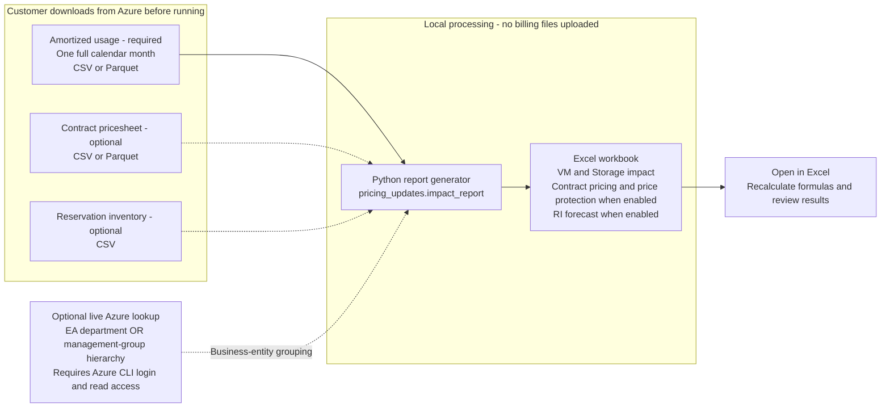

# Azure Pricing Impact Report

Calculate regional and legacy VM price-change impacts from Azure usage exports,
with optional price protection and Reserved Instance forecasting.

**First time using the tool?** Follow the [Customer guide](CUSTOMER_GUIDE.md)
for the dependency order, EA/MCA input downloads, installation, full-run
commands and result checks. See [Permissions](PERMISSIONS.md) for access roles.

> [!WARNING]
> **Disclaimer:** Although the Azure Pricing Impact Report is developed by
> Microsoft employees, it is not a Microsoft service or product. It is an
> independently driven project. There are no implicit or explicit obligations
> related to this project; it is provided "as is," with no warranties, and
> confers no rights.
>
> **Indicative results only:** The figures produced by this tool are estimates
> based on past observed usage and on the pricing inputs you supply (usage
> export, pricesheet, reservation inventory). They are indicative, may still
> contain mapping or calculation inaccuracies, and actual future charges may
> differ. Validate the results against Azure Cost Management and your agreement
> terms before using them for budgeting, forecasting or commercial decisions.
> They do not replace official Microsoft pricing communications.

The entry point
is `pricing_updates.impact_report`; the modules under `core` are included
dependencies, not separate tools.

## Inputs and output at a glance



**Basic report:** usage only. **Price protection:** usage + pricesheet.
**RI forecast:** usage with VM reservation data + pricesheet + reservation
inventory. Optional inputs enable features through the corresponding command
options; see [Parameters](#parameters).

The tool does **not** download the input files automatically. Without
`--business-entity-method`, report generation runs offline on your files and
requires no Azure login.

## Announcement scope

This tool models the Azure price changes communicated by Microsoft on
28 September 2026. It
reflects that announcement only. If a later announcement changes the scope,
rates or dates, the tool must be updated accordingly (see
[How the announcement is implemented](#how-the-announcement-is-implemented)).

**Legacy VM series, about 25% from 1 February 2027** (all regions):

- v1: Bv1, D, Ds, F, Fs, G, Gs, Ls, NP, HC.
- v2: Av2, Amv2, Dv2, Dsv2, Fsv2, Lsv2.

**Regional price update, from 1 February 2027.** Specific Azure Virtual
Machines and Azure Storage services are adjusted in these regions, with
increases ranging from 8% to 17% depending on the region: EU West, EU North, France Central, France South, Norway East, Norway West, Southeast Asia.

Announced as not covered by the regional update:

- VM series: v1 and v2 (they get the legacy increase above) and v7 Dsv7, Ddsv7,
  Dlsv7, Dldsv7, Esv7, Edsv7.
- Storage: Azure Container Storage, Azure Managed Lustre, Azure NetApp Files
  Cross Region Replication SKU, Blob Features, Change Feed, General Block Blob,
  Import/Export, Queues, Queues v2, Standard Page Blob, Storage Actions,
  Storage Bandwidth, Storage Discovery, Tables, Transaction Optimized SKU.

These increases apply to pay-as-you-go, Enterprise Agreement and Microsoft
Customer Agreement rates. Existing Reserved Instances (RIs) are not affected
until they expire, and savings plans follow the updated VM rates.

**VM series retirement dates for reference.** The RI forecast uses them to decide whether a new commitment
is still possible:

| Series | Retirement date | Announcement |
| --- | --- | --- |
| D, Ds, Dv2, Dsv2, Ls | 1 May 2028 | [Azure update 485569](https://azure.microsoft.com/en-us/updates/?id=485569) |
| F, Fs, Fsv2, Lsv2, G, Gs, Av2, Amv2, Bs (v1) | 15 November 2028 | [Azure update 500682](https://azure.microsoft.com/en-us/updates/?id=500682) |
| NP | 31 May 2027 | [Azure update 548497](https://azure.microsoft.com/en-us/updates/?id=548497) |
| HC | 31 May 2027 | [Azure update 548543](https://azure.microsoft.com/en-us/updates/?id=548543) |
| Dv3, Dsv3, Ev3, Esv3 | 15 November 2029 | [Azure update 572346](https://azure.microsoft.com/en-us/updates/?id=572346) |

## Prerequisites

See [Permissions](PERMISSIONS.md) for the read-only roles and scopes needed
to download all inputs and use optional live business-entity lookups.
Running on existing files requires no Azure permissions or login.

- Python 3.10 or newer, and Git (or download the repository as a ZIP).
- Azure CLI ([install guide](https://learn.microsoft.com/cli/azure/install-azure-cli)),
  only for `--business-entity-method` (see [Parameters](#parameters)).
- Billing exports from your own tenant:

| Input | Required | Content | Where to find it |
| --- | --- | --- | --- |
| Usage details | Always | EA or MCA **amortized cost** usage for a full calendar month, CSV or Parquet (file, folder or glob). | Azure Cost Management + Billing > Billing scopes > EA billing account or MCA Billing Profile > For MCA create an amortized usage report, For EA you can download it from Invoice pane (choose amortized) |
| Pricesheet | With `--price-protection` or `--ri-price-evolution` | CSV or Parquet. Its contract type (EA or MCA) must match the usage | Azure Cost Management + Billing > Billing scopes > EA billing account or MCA Billing Profile > Invoices > Download Azure pricesheet |
| Reservation inventory | With `--ri-price-evolution` | CSV with `Reservation Id`, `Reservation order Id`, `Purchase date`, `Expiration date`, `Product name` | Azure Cost Management + Billing > Billing scopes > EA billing account or MCA Billing Profile > Reservations > Export to CSV |

## Installation

The commands in this document are PowerShell. On Linux or macOS, adapt the
paths and activate the environment with `source .venv/bin/activate`.

```powershell
git clone https://github.com/gibet-code/az-pricing-updates.git
cd az-pricing-updates
python -m venv ".venv"
& ".\.venv\Scripts\Activate.ps1"
python -m pip install -r ".\requirements.txt"
python -m pricing_updates.impact_report --help
```

## Running the tool

Run from the repository root with the virtual environment active.

> **Large CSV exports.** Parquet loads much faster than CSV. For usage-details
> CSV files larger than about 1 GB, convert them to Parquet first. The usage
> converter streams the file in bounded memory, so very large exports do not
> exhaust RAM. Pricesheet CSVs can be converted the same way to speed up repeated
> runs. Both accept a file, a folder of CSV files or a glob:
>
> ```powershell
> python -m scripts.convert_usage_details_to_parquet ".\inputs\usage-csv" ".\inputs\usage.parquet"
> python -m scripts.convert_pricesheet_to_parquet ".\inputs\prices.csv" ".\inputs\prices.parquet"
> ```

Basic impact report (usage only):

```powershell
python -m pricing_updates.impact_report ".\inputs\usage.parquet" --output ".\reports\impact.xlsx"
```

With the pricesheet and price protection:

```powershell
python -m pricing_updates.impact_report ".\inputs\usage.parquet" --output ".\reports\impact.xlsx" --pricesheet ".\inputs\prices.parquet" --price-protection
```

With the RI forecast and a cache, so the same data can be re-run with other
parameters:

```powershell
python -m pricing_updates.impact_report ".\inputs\usage.parquet" --output ".\reports\impact.xlsx" --pricesheet ".\inputs\prices.parquet" --reservation-inventory ".\inputs\reservedInstances.csv" --ri-price-evolution --ri-price-evolution-horizon-months 18 --ri-price-evolution-fiscal-year-start-month 4 --cache-dir ".\cache"
```

## Parameters

| Parameter | Required | Depends on | `az login` | Effect |
| --- | --- | --- | --- | --- |
| `usage_file` (positional) | Yes | | No | Usage CSV/Parquet file, folder or glob |
| `--output` | Yes | | No | Path of the Excel workbook to create |
| `--pricesheet` | No | | No | Adds the Storage/VM pricesheet tabs and the pricesheet metadata block |
| `--price-protection` | No | `--pricesheet` | No | Caps the increased PAYG price at the pricesheet `BasePrice` (EA or MCA, detected from the usage) |
| `--reservation-inventory` | No | Amortized usage | No | Adds the Reservations tab and fills reservation purchase/expiration dates and VM size |
| `--ri-price-evolution` | No | `--pricesheet`, `--reservation-inventory`, VM reservation usage | No | Adds the RI forecast tabs |
| `--ri-price-evolution-horizon-months` | No (18) | `--ri-price-evolution` | No | Number of forecast months, at least 1 |
| `--ri-price-evolution-fiscal-year-start-month` | No (1) | `--ri-price-evolution` | No | First month of the forecast fiscal year, 1 to 12 |
| `--business-entity-method` | No | | **Yes** | Adds `BusinessEntity` from `ea_department_name` or `management_group_hierarchy_level_0` to `_6`; missing values are `Unknown` |
| `--cache-dir` | No | | No | Reuses parsed inputs between runs (see [Azure login and caching](#azure-login-and-caching)) |
| `--keep-no-impact-details` | No | | No | Keeps non-impacting rows in the Storage and Virtual Machines tabs; by default only impacted rows are exported |

Run `python -m pricing_updates.impact_report --help` for the full option list.

## Inputs and expected results

| You provide | You get |
| --- | --- |
| Usage only | `Non-RI Pricing Impact`, `Storage` and `Virtual Machines` tabs. Impact is the announced percentage applied to the usage cost. The tab note suggests re-running with `--ri-price-evolution` to see the impact of reservations |
| Usage + `--pricesheet` | Adds `Storage Pricesheet` and `VM Pricesheet` tabs, a Pricesheet Metadata block, and a reservable status on Storage usage |
| + `--price-protection` | The impact is limited by the pricesheet `BasePrice`; rows carry a price-protection status |
| + `--reservation-inventory` | Adds the `Reservations` tab and reservation purchase/expiration dates on reservation rows |
| + `--ri-price-evolution` | Adds the `RI Price Evolution` dashboard, `RI Projection Details` and `RI Evolution Assumptions` tabs. The Non-RI tab note then points to the dashboard |
| + `--business-entity-method` | Adds a `BusinessEntity` column and an Impact by Business Entity section |

The report fails early, before any Azure call, when usage contains several
pricing currencies, the pricesheet and usage contracts differ, or required
columns or options are missing. A usage period other than one complete calendar
month produces a warning; the forecast treats the usage as a constant
reference month. Forecast results that cannot be priced (for example a missing
expiration date or fallback price) are shown as **Unpriced**, never as zero.

## How the announcement is implemented

The impact of each usage row is `cost x percentage / 100`, using the cost in
the pricing currency over the exported usage period. A row is classified as
`Region Price Update`, `v1-v2 Price Update` or `No Impact`.

| Announcement | Implementation | Code |
| --- | --- | --- |
| Regional percentages | Usage `MeterRegion` is translated to the region codes `EU West`, `EU North`, `FR Central`, `FR South`, `NO East`, `NO West` and `AP Southeast`, each with its announced percentage. Rows without a meter region or in other regions have no regional impact | `PRICE_INCREASE_BY_REGION` in `pricing_updates/price_impact/impact.py`; `core/region_translation` |
| Regional update, Storage | Usage with meter category `Storage` or `Azure NetApp Files` in an impacted region, except the announced exclusions. They are matched on the meter sub-category (see the naming table below), plus Azure NetApp Files meters whose name contains Cross Region Replication | `add_storage_impact_result`, `EXCLUDED_STORAGE_METER_SUBCATEGORIES` |
| Regional update, VMs | Usage with meter category `Virtual Machines` in an impacted region. The series comes from the meter sub-category (or the product when empty). v7 series Dsv7, Ddsv7, Dlsv7, Dldsv7, Esv7 and Edsv7 are excluded | `add_vm_impact_result` |
| Legacy v1/v2 VM increase | Series matching Bs, D/Ds, F/Fs, G/Gs, Ls, NP, HCS, Av2, Amv2, Dv2/Dsv2, Fsv2 or Lsv2 (promo variants included) get 25% in every region. This takes precedence over the regional update; the two never stack | `VM_SERIES_RETIREMENTS`, `LEGACY_PRICE_UPDATE_VM_PATTERN` |
| VM family and retirement date | The same series table gives each VM row its family (for example `Dv2/Dsv2`) and retirement date, written to the `VMFamily` and `RetirementDate` columns of the Virtual Machines tab. It also lists the retirement-only series Dv3/Dsv3 and Ev3/Esv3 (no price increase). Other series stay blank | `VM_SERIES_RETIREMENTS`, `classify_vm_series` |
| Pricing models | OnDemand usage gets the percentage. Spot and Savings Plan are described below. Reservation rows are calculated in the detail tabs but excluded from the Non-RI summary | `build_impact_summaries` |
| Existing RIs unchanged until expiry | Handled by the RI forecast, below | `pricing_updates/price_impact/ri_evolution.py` |
| Price protection (optional, not part of the announcement) | For OnDemand usage, the increased unit price is capped at the pricesheet `BasePrice` converted to the usage unit. EA uses the highest matching `BasePrice` of the meter and offer; MCA uses the highest for an Azure plan and the lowest otherwise | `_apply_price_protection` |

**Storage exclusions and EA/MCA naming.** All announced Storage exclusions sit
under the `Storage` meter category. EA and MCA name some sub-categories
differently, so both spellings are excluded:

| Announced exclusion | EA sub-category | MCA sub-category |
| --- | --- | --- |
| Storage Bandwidth | `Bandwidth` | `Storage - Bandwidth` |
| Azure Container Storage | `Azure Container` | `Azure Container Storage` |
| Storage Actions | `Actions` | `Storage Actions` |
| Storage Discovery | `Discovery` | `Storage Discovery` |
| Azure Managed Lustre, Import/Export | same name | same name |
| Blob Features, Change Feed, General Block Blob, Queues, Queues v2, Standard Page Blob, Tables | same name | same name |
| Transaction Optimized SKU | `Files` (assumption, below) | `Files` (assumption, below) |

The names were checked against EA and MCA usage details and pricesheets; the
code comments record whether each value was seen in EA, MCA or both. A name
that neither contract uses today, or a future rename, would not be excluded.

> **Assumption: Storage `Files`.** The announced Storage exclusions include the
> Transaction Optimized SKU. No meter carries that name, so the tool assumes it
> corresponds to the `Files` meter sub-category, which is excluded. Files usage
> also carries almost no `MeterRegion`, which supports this assumption.

> **Assumption: Inter-Region Bandwidth.** `Inter-Region Bandwidth` (EA) and
> `Storage - Inter-Region Bandwidth` (MCA) are bandwidth meters, but the
> announcement does not list them among the exclusions. The tool assumes they
> are impacted and applies the regional percentage when they carry an impacted
> region.

**Spot.** The announcement does not mention Spot. The tool applies the same
regional or legacy percentage as for OnDemand, as an assumption.

**Savings Plan.** The percentage is applied to the Savings Plan usage cost, so
the modeled scenario follows the PAYG price increase. Achieving it requires
buying additional Savings Plan commitment so the same workload stays covered.
The alternative is to keep the existing commitment only: it then covers less of
the workload, the rest is billed at PAYG rates, and the cost increase is higher
than the announced percentage. The tool models only the first option; the
second may be modeled later and taken into account by the tool. The
Non-RI Pricing Impact tab carries a short note to that effect.

**RI forecast.** For existing VM reservation usage and unused commitment only,
cost stays at the current amortized level until the reservation expiration
month. From then, with the effective date 1 February 2027, it moves to the first
available option of the selected fallback chain (`RI 3Y` then `SP 3Y` then
`PAYG`; `SP 3Y` then `PAYG`; or `PAYG`). Prices come from the pricesheet,
multiplied by the announced percentage when the price applies on or after
1 February 2027. `RI 3Y` is unavailable when it would start within 3 years of
the VM series retirement, and `SP 3Y` when it would start on or after it. After
retirement, the last known PAYG price is assumed to continue. A series that is
not in the retirement table is assumed to continue indefinitely.

**Retirement dates.** They are derived from the VM series name with the table
described above, so no Azure call is needed. The dates come from the
announcements listed in the scope section; a new announcement requires updating
the table in `pricing_updates/price_impact/impact.py`.

## Limitations

Read the figures as indicative estimates, keeping these points in mind:

- They are based on past observed usage; usage growth, migrations and
  optimizations after the export are not modeled.
- The impact is the announced percentage applied to the usage cost, not a
  recomputation from the new unit prices. Price protection and the RI forecast
  are the only places where pricesheet prices are used.
- Assumptions taken by the tool, because the announcement is silent or
  ambiguous: Spot is treated like OnDemand; Savings Plan follows the PAYG
  increase (additional commitment); `Files` stands for the Transaction
  Optimized SKU; Inter-Region Bandwidth is impacted.
- Storage exclusions are matched on meter sub-category names as observed in EA
  and MCA data. A renamed or new meter would not be excluded.
- The RI forecast covers VM reservation usage and unused commitment only,
  and treats the usage as a constant reference month. Other reservations, such
  as Storage reserved capacity, are excluded from the Non-RI summary and are
  not forecast.
- Retirement dates exist only for the series named in the announcements
  (v1/v2, Dv3/Dsv3 and Ev3/Esv3). Other series are assumed to continue
  indefinitely, and a size with an individual earlier retirement date is not
  distinguished from its series.
- Only the 28 September 2026 announcement is modeled.

## Workbook

| Worksheet | Included when | Contents |
| --- | --- | --- |
| Non-RI Pricing Impact | Always | Usage metadata, pricesheet metadata (pricesheet supplied), overall impact per non-RI pricing model, and impact by business entity (when enabled) and subscription. The entity/subscription sections are formulas over the Storage and Virtual Machines tables, with a pricing-model drop-down (default All; Reservation is always excluded) |
| Storage | Always | Classified Storage/NetApp Files usage and calculated impact, as Excel table `StorageData` |
| Virtual Machines | Always | Classified VM usage and calculated impact, with `VMFamily` and `RetirementDate` for the series named in the announcements, as Excel table `VirtualMachinesData` |
| Reservations | Inventory supplied | All inventory records, without internal matching fields or the deep-link column |
| Storage Pricesheet | Pricesheet supplied | Matching Storage/NetApp Files prices |
| VM Pricesheet | Pricesheet supplied | Matching VM prices, including the full VM scope needed for forecasting |
| RI Price Evolution | Forecasting enabled | Monthly dashboard, filters and chart; placed after Non-RI Pricing Impact |
| RI Projection Details | Forecasting enabled | Monthly aggregated projections by fallback and reporting dimensions |
| RI Evolution Assumptions | Forecasting enabled | Forecast assumptions and the retirement dates used |
| RI Evolution Chart Data | Forecasting enabled, hidden | Dashboard chart source |
| RI Evolution Lists | Forecasting enabled, hidden | Selector values and named ranges |

The Non-RI Pricing Impact tab excludes existing RI costs, because existing
commitments keep their current price until expiration. Its note points to the
RI Price Evolution tab when forecasting is enabled, or suggests rerunning with
`--ri-price-evolution` otherwise. The forecast compares the RI 3Y, SP 3Y and
PAYG fallbacks after expiration.

Open the workbook in Excel to calculate dashboard formulas. Recalculation is
requested on opening; the Python writer does not evaluate Excel formulas.

**Reading the Non-RI Pricing Impact tab.** Amounts are the estimated increase
over the exported usage period (a full calendar month gives a monthly impact),
in the pricing currency. *Overall Impact* has one row per non-RI pricing model
and a total. The *Impact by Business Entity* and *Impact by Subscription*
sections are formulas over the Storage and Virtual Machines tables; the pricing
model drop-down above them (default All) filters both, and Reservation is never
included. Columns split the impact into Storage regional, Virtual Machines
regional and v1-v2 price updates.

## Azure login and caching

**Data stays local.** The usage, pricesheet and reservation files are processed
on your machine and nothing is uploaded. Azure is contacted only by
`--business-entity-method`.

**Azure login.** Run `az login` only for `--business-entity-method`, which reads
management groups or the EA department live. Everything else, including the RI
forecast, works offline on your files.

**Caching.** Off by default. `--cache-dir` stores the parsed usage and the
parsed pricesheet. It is useful when you run the script several times on the
same data with different parameters: large files are not re-read. The
reservation inventory and business-entity lookups are never cached.

## License

This project is licensed under the [Apache License 2.0](LICENSE). Third-party
components remain subject to their respective licenses.
